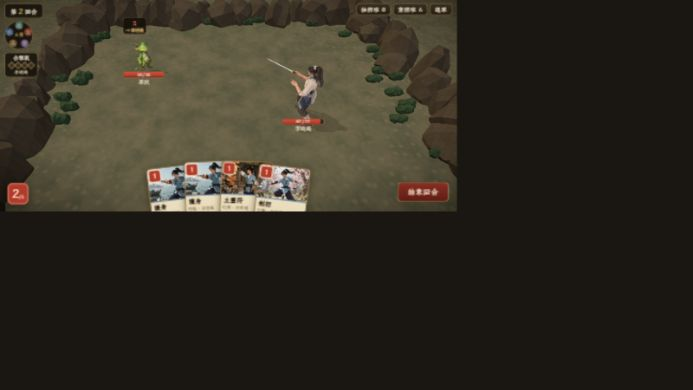

# 線上戰鬧美術與效果試玩評估 — VISUAL-001

2026-10-05，Codex。評估完成 100%；下列改善項目尚未實作。正式 Three.js 網址：https://xiaoyao-private-play.googoo00166.chatgpt.site/ 。本輪使用瀏覽器 UI 實際操作，不注入戰鬥狀態、不替換資產、不部署。

## 試玩範圍與證據

使用原本空白的第 3 存檔欄，新故事 → 餘杭客棧 → 仙靈島迷陣。李逍遙單人對兩隻草妖，三回合勝利，結束生命 67/72。實際打出劍招、護身、土靈符；觀察敵方撲咬、護體抵擋、扣血、擊殺和勝利提示。比較 1280×720 桌機與 844×390 手機橫向尺寸，結束後已恢復瀏覽器預設尺寸。試玩欄位保留，沒有覆蓋其他存檔。

**限制**：手機為瀏覽器尺寸模擬，不是實體 Android 的觸控、GPU 或音訊測量。本輪未試玩 Boss、三人隊、其他四位主角或全部五靈仙術；不能由首戰推定全專案美術已驗收。截圖為瀏覽器 JPEG，不以壓縮造成的模糊判定正式貼圖品質。未播放／測量音訊，因此音畫同步屬待驗收方向。

| 證據 | 用途 |
|---|---|
| [桌機攻擊後](previews/battle-visual-review-v1/live-island-after-attack.jpg) | 正常比例角色、敵人站牌、低多邊形場景與卡圖的畫風差異 |
| [防守打出](previews/battle-visual-review-v1/live-island-guard-played.jpg) | 護身演出早期影格；完整結算另由 DOM 確認護體 5 |
| [敵人回合](previews/battle-visual-review-v1/live-island-enemy-turn.jpg) | 敵回合早期影格；完整結算後生命 72→67 |
| [手機單敵](previews/battle-visual-review-v1/live-island-mobile-single-enemy.jpg) | 畫面構圖、卡片與 HUD 尺寸 |
| [土靈符](previews/battle-visual-review-v1/live-island-mobile-earth-cast.jpg) | 施法早期影格；結算草妖 18→14、護體 +5 |
| [勝利](previews/battle-visual-review-v1/live-island-victory.jpg) | 第三回合勝利提示 |

動畫截圖是離散影格，不能單獨證明整段演出沒有某種效果。以下以實際操作感受及來源程式互相核對。

## 核心判斷

新備戰姿勢已有屈膝、錯步與持劍戒備，改善了直立問題；但現在主要不足是**同一戰場的美術語言不一致、交戰距離過遠、動作與命中缺少有辨識度的演出**。再加大量粒子無法解決這三點。

保留使用者選定 D 的正常人體比例，絕不回到 Q 版、大頭短腿或玩具比例。原作的裝束與兵器辨識優先，材質可以簡化，但不能改成精緻真人皮膚或泛用仙俠設計。相似度不在本輪給出虛構百分比。

## 實際觀察與來源核對

| 問題 | 證據與影響 | 改善方向 |
|---|---|---|
| 主角／敵人／場景／卡圖畫風混用 | 李是有體積與明暗的正常比例 3D；草妖是繪畫站牌；岩石是明顯切面，地面為模糊斑塊；卡圖又是不同裝束與畫法。 | 以 D 的正常比例、原作裝束和遊戲化材質為共同基準。敵人不必一次全改 3D，但輪廓、用色、受光和接地必須一致。卡圖改造放在角色定案後。 |
| 構圖交戰感弱 | 中央空地很大，草妖小且靠上方，李主要從背側被看見；鏡頭下屈膝姿勢仍顯得後仰。 | 稍降俯角並重排站位、縮短視覺間隔，讓肩線、前膝和劍尖朝敵。保留完整身形，不用放大頭部解決辨識。先滿 UI、三人隊與大 Boss 驗收再定鏡頭。 |
| 明暗／接地不一致 | 李有廣而較淡的投影，敵人與環境體積感不同。Billboard.tsx 用 MeshBasicMaterial、toneMapped=false，與模型的受光方式不同。 | 統一冷暖與明暗范圍、脚底接觸陰影；2D 敵人採適度受光／色調策略，避免只加深全場或用強 bloom 補救。 |
| 劍招命中力度不足 | 目前主要是位移、閃光、跳字。playback.ts 的 Beat 是 lunge/clip/flash/popup，沒有武器軌跡／接觸點特效描述。 | 劍尖短軌跡、碰撞點火花／斬線、短暫受擊停頓、重心反應。武器接觸、扣血、數字和音效對齊同一拍，數值先提出候選再實測。 |
| 防守與施法姿勢辨識不足 | 實際施放護身與土靈符；現有李 GLB 只有 idle/attack/hit，Actor.tsx 找不到 guard/cast 時退回 idle。 | 加 guard/cast/recover 動作，護身用短符紋或局部護體反光，土術作用在目標腳下。不要讓所有仙術都只是角色平移與跳字。 |
| 目標提示像方框 | 選牌時可見矩形黃色目標框，破壞場景感。單敵仍需選牌再點敵。 | 保留大觸控區但隱藏矩形邊框，改腳下標記＋淡輪廓。唯一合法目標快出沿用 FEEL-002–005 計畫，不另建第二套輸入邏輯。 |
| 手機卡片閱讀與頁面位移 | 844×390 中卡面说明小、卡片下緣靠出畫面；語意點選牌時曾使整個畫面上移、頂部 HUD 被裁切，截圖下方出現黑帶。 | 檢查文件滾動／選牌抬升／安全區與動態視窗高度；重要操作與卡名常駐，詳文用長按。裁切在模擬環境發生，不直接斷言實體手機同樣失效。 |
| 仙靈島場景辨識不足 | 石圈、重複塊狀草叢、斑駁地面壓過場景特色。当前原作 recipe 的土褐／橄欖綠本身有來源，不能任意改成通用仙境。 | 對照原作同場景，调整岩層、地表層次、路径、岸邊等可核對元素；少量局部環境运動即可，避免无意义漩涡和漂浮粒子。 |

## 任務分派與順序

所有後續項目均待開始；這是評估交接，不代表已認領或已完成改造。遵守 TASKS.md 的 Claude 主／Codex 輔分工，CLI 不可用時由 Codex 依既有授權推進，開始前更新認領範圍。

| 任務 | 優先 | 建議負責與範圍 | 可驗收結果 |
|---|---|---|---|
| VISUAL-002 畫面閱讀與目標提示 | P0 | Claude：Hand/BattleScreen/ui.css；與 FEEL 任務共享輸入修正 | 844×390/740×360、滿手牌＋三藥＋六遺物，選牌和結算時 HUD 不裁切；目標明確、卡名和重要數值可讀。實體手機另驗收。 |
| VISUAL-003 構圖與共同美術基準 | P0 | Codex：formation/BattleStage、角色與場景；角色重製接 CHARACTER-004/005 | 同場景比較單人／三人／大 Boss；正常比例、武器清楚、脚不飘、場景有原作特徵。候選新檔先驗收再替換。 |
| VISUAL-004 劍招命中演出 | P1 | Claude：playback/BattleScreen 事件時序；Codex：Actor／武器特效 | 慢速逐影格確認預備→出劍→接觸→受擊→收勢；0 HP 清場時不丟失最後擊中回饋。普通攻擊短而乾脆，不把每張牌做成大招。 |
| VISUAL-005 防守與施法動作 | P1 | Codex：GLB guard/cast/recover；Claude：clip 調度與符效規格 | 護身、劍招、土靈符不看卡名也能辨認動作；首尾回到 ready，腳底穩定、衣袖／武器不穿模。其餘五靈分步驗收。 |
| VISUAL-006 光影與環境細節 | P2 | Codex：Billboard/toon/scene recipes/BattleStage | 高／低品質都保留輪廓和接地、角色不過曝；移除具象石块重複感；手機實測幀率再定粒子與陰影預算。 |

先完成 P0，再以李逍遙＋草妖＋仙靈島作為小范圍战斗視觉樣板，確認後擴展主角群、敵人和場景。不要一次重绘全部資产再發現方向不對。

## 來源與回歸要求

程式核對：src/ui/battle/playback.ts、BattleScreen.tsx，src/stage/Actor.tsx、Billboard.tsx、BattleStage.tsx、toon.ts、formation.ts，src/ui/ui.css、src/stage/scenes/palSceneRecipes.ts。相關互動評估見 [CARD_FEEL_REVIEW.md](CARD_FEEL_REVIEW.md)。

原作場景基準：PAL1 DOS [仙靈島原作戰鬥圖](https://codingman.cc/images/pal-dos-walkthrough/ch1-04-island-path-battle.webp)，既有本機參照與場景 recipe。這輪没有繪圖；後續绘制／正式資产修改仍須按原作参考 Gate 展示來源、保留核心造型，並按既有用户授权處理確認。

本轮只有文件和截圖变更，未重跑與變更無關的遊戲測試。後續正式實現需跑受影響的機制測試／build、逐影格檢查與桌機／手機满 UI 實機截圖；音畫同步、性能和觸控最终須真實设备驗收。
