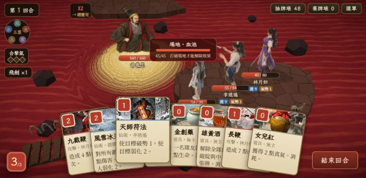

# 戰鬥視覺首批修正 — 2026-10-06

本批交付完成度 100%；不是 VISUAL-002–006 全部完成。沿用 D 正常比例方向，沒有生成或替換角色／場景插圖。

## 畫面變化

- 手牌底部改為正值留白，收斂扇形旋轉；手機牌面 12px、效果 11px，八牌按可用寬度加深重疊，避開真氣與結束回合按鈕。選牌抬起／長按仍提供完整閱讀。
- game-root 使用 fixed 與 overflow:clip，避免選牌或瀏覽器捲動將整個 HUD 拉走。根容器沒有改劇情文字逐字排版。
- 透明大命中區保留，金色大矩形換為真實 3D 地面圈。未預選拖曳也啟用目標；hover 不再覆寫跟手位移。取消手勢清掉起點、預覽、目標。
- 所有出牌入口檢查 canPlay，目標分類改用 effectiveCard，避免心念牌分類不同或非法點擊拋出錯誤。仍須選擇多個合法目標，未實作唯一目標快出。
- 雙方中心由 [2,1.25]/[-1.9,-1.2] 改為 [1.65,.95]/[-1.55,-.8]，保持 PAL 左上／右下斜線。鏡頭看向點往前排偏移，腳下 HUD 限位在手牌上方；推鏡縮為 8%，減少大 Boss 頭部裁切。
- 血池漩渦使用同一個 PAL_FORMATION 敵方中心，原有連動測試已通過。
- 招式 banner 原本带有通用 .card class，意外套用原型卡片寬高，產生大方框。改為 bt-banner-card 等專屬 class，放到畫面上方。
- 普通攻擊前置 330→260ms、敵招 380→300ms，衝刺保留至 410ms，使接觸前不先退回原位。
- 接觸事件與 HP、閃白、受擊、音效同一拍，短劍光＋七條火花，格擋藍圈／回血綠圈。0.3 秒透明淡出，不依賴 bloom；低畫質也能播放。事件獨立於 actor，敵人移除不會截斷接觸效果。

## 驗證

`npm run build` 通過。`npm test`：119 passed、1 skipped。新增演出測試驗證擊殺先接觸／扣血／受擊，下一拍才移除；完全格擋及零治療分類。

使用正式 BattleScreen 試打仙靈島迷陣劍招，草妖 18→12；血池三人隊使用天師符法及長鞭，Boss 弱化／破勢與 160→153 正確。DEV 專用 `?dev=3:c3_bloodpool&visualqa` 建構八張手牌、三種藥牌及六件法寶；沒有改正式資料或線上存檔。六件法寶套用既有護體／氣勢／飛劍效果；正式 HUD 本來沒有六格法寶圖示，不把它描述成新增圖示列。

尺寸驗收 1280×720、844×390、740×360。740×360 未抬起八牌邊界 x≈120–620、bottom≈355，結束回合按鈕 x≈631–724；document scroll 為 0。選牌抬起仍可局部覆蓋前排 HUD，不能據此宣稱所有狀態都不重疊。背景瀏覽器截圖不能代表真實 Android 幀率、觸控或音效節奏。

其他驗收圖：boss-desktop.jpg、boss-844-target.jpg、boss-strike.jpg。部分演出圖記錄迭代過程，最後推鏡已降低；靜態截圖不能證明 0.3 秒粒子每一幀的節奏。

## 留待後續

真正武器骨骼軌跡／hit-stop、五靈專屬演出、guard/cast GLB 動作、其餘角色 D 正常比例重製、場景／材質統一、實體手機效能與完整拖曳回歸。首批程式修正不代表原作美術相似度已完成。

發布：原私人網址部署 succeeded（appgdep_6ac3cd1b9ed881919028eb6b52986255）；Sites 靜態源 0244558c4f50df848c14d2ecbe8084be71f49b4c，網址 https://xiaoyao-private-play.googoo00166.chatgpt.site/。
