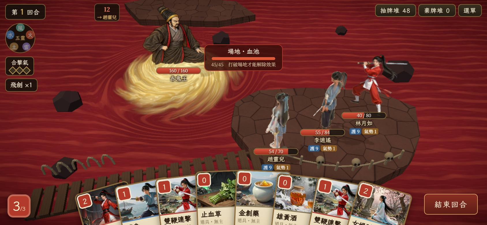

# 血池 Three.js 正式場景 — SCENE-001B／D

2026-10-05，Codex。這批只交付血池候選，其他 22 場另排；使用者美術驗收與 Android 實機驗收另列。

**最新狀態：100% 完成。** 使用者已確認 DOS 赤鬼王與新版旋流；血池已由 sceneId 自動選取完整 3D 地面，開發與正式建置皆有效。其他 22 場仍待原作精修與 3D 製作。Android 實機效能尚待測試。

## 原作與確認

使用者查看 PAL1 DOS 的血池戰鬥與探索截圖後回覆「按原作圖製作」。版本、來源與可辨識元素見 [原作參照](art-references/blood_pool.md)。

候選保留紅色橫向波紋血海、赤鬼王腳下的金色旋流、右方暗紅褐岩岸，以及探索場景的木橋、平頂岩島和骨籬。沒有沿用第一版生成背景的高祭壇柱。

這批全部用 Three.js 幾何與材質建構：血水 shader 緩慢流動、岩岸有頂面和斷面、橋板與骨骸使用 instancing。沒有修改角色、敵人造型、鏡頭、站位、燈光或戰鬥規則。

## 正式接線與 Claude Code 接手

正式 BattleScreen 傳入 `sceneId=blood_pool` 即自動啟用，無需候選 query。開發跳關可用 `http://localhost:5173/?dev=3:c3_bloodpool&scenePerf`；production 從正常選單／正式存檔進入。

- catalog 的 `environment: "blood_pool"` 對應 lazy-loaded `BloodPoolScene.tsx`；不再載入舊 blood_pool.jpg。JPG 保留作明確自訂背景的相容資產。
- 明確 `backdropUrl`、`backdropLayout` 或 `scenery` 優先，會停用自動完整地面；未知 sceneId 仍回退十里坡。
- 省電模式停用水面動畫，沿用舞台 DPR 1、無後製。scenePerf 僅開發用。
- 原有鏡頭、站位、核心與 UI 不變。角色仍為獨立呈現，3D 場景完成不代表全角色 3D。

`buildBloodPoolScenery()` 回傳 `{ group, update(elapsed, reducedMotion), dispose() }`。R3F 入口 `BloodPoolScene.tsx` 在 StrictMode 下安全清理。

正式建置驗收：`node tools/stage/capture-blood-release.mjs`，結果 [validation.json](previews/blood-release/validation.json)。桌機／844×390 DPR2 手機觸控／省電均 0 錯誤、0 HUD 超界、0 舊地面請求；三藥品＋六遺物＋八張手牌，治療、出牌與觸控長按預覽通過。`npm run build`、89 個測試通過（1 跳過）。



以下為首批候選的歷史驗證：

## 技術與畫面驗證

```text
npm run build
npm test
node tools/stage/capture-blood-pool.mjs
node tools/stage/capture-blood-pool-medicine.mjs
```

截圖工具走正式 UI 點牌／選目標，等待模型、材質、字型與首次渲染完成，記錄瀏覽器錯誤、HUD 超界、手牌扇形裁切及全幀繪製資料。

首批額外場景預算：**9 draw、4,426 三角面**。SCENE-001C 旋流修正後為 **9 draw、15,178 三角面**，仍低於 20 draw／30,000 面。靜態檢查包含全部 instance；角色、陰影與後製另計。

擁擠 QA 存檔用 Node 的 Vite SSR 載入正式核心，持有酒葫蘆、玉佛珠、風靈珠、雷靈珠、土靈珠、七星劍，重新套用法寶開場效果。手牌包含三張藥品卡（止血草、金創藥、雄黃酒）及五張招式，共八張。

Three.js 網頁版的藥品是道具卡，沒有舊 Godot 的三格藥瓶或常駐遺物欄。因此用實際藥品手牌與多件法寶的護體／氣勢／飛劍 HUD 做擁擠驗證，不用空白開局作為驗收圖。

最終結果：建置通過；**87 個測試通過、1 跳過**。五組桌機／手機／省電／擁擠 UI 均可出牌、沒有 HUD 超界、瀏覽器錯誤 0。完整舞台含兩個角色模型、兩張立繪、陰影與後製：高畫質 **49 draw／64,589 面**，省電 **32 draw／64,572 面**。

手機補驗：三張藥品長按後，名稱與效果完整位於螢幕內，放開不出牌；點金創藥再選李逍遙，HP 從 55/84 → 75/84，藥品消耗，HUD 保持可見，錯誤 0。已實際查看驗收截圖；[補驗紀錄](previews/blood-pool/medicine-validation.json)。

### 畫面

- [桌機](previews/blood-pool/desktop.jpg)
- [手機橫向](previews/blood-pool/mobile.jpg)
- [手機省電](previews/blood-pool/mobile-low.jpg)
- [桌機擁擠 UI](previews/blood-pool/desktop-crowded.jpg)
- [手機擁擠 UI](previews/blood-pool/mobile-crowded.jpg)
- [手機藥品長按](previews/blood-pool/mobile-medicine-2.jpg)、[選人治療](previews/blood-pool/mobile-medicine-used.jpg)
- [完整驗證紀錄](previews/blood-pool/validation.json)、[QA 道具與預算](previews/blood-pool/fixture.json)

手機截圖是桌機 Chromium 的 844×390、DPR 2 模擬；效能數字來自桌機瀏覽器環境，不能當作 Android WebView 實機通過。手牌扇形底部裁切及手機隱藏敵人招式名稱是現有 UI 行為，工具單獨記錄，不算候選場景造成的超界。

正式畫面若要另調 Boss 頭頂裁切、出招推鏡時其他角色出畫面或手牌閱讀空間，屬 Claude 的 UI／演出範圍；這批保留其鏡頭和站位。
