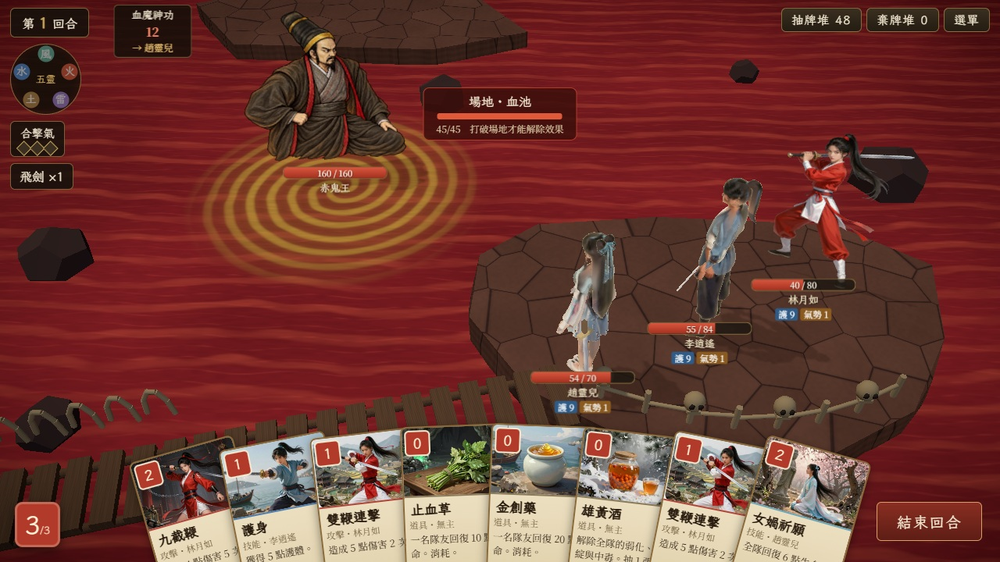
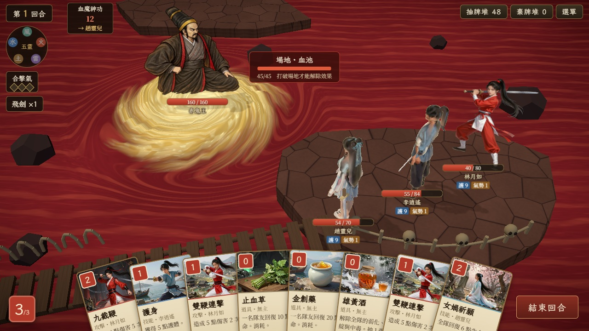
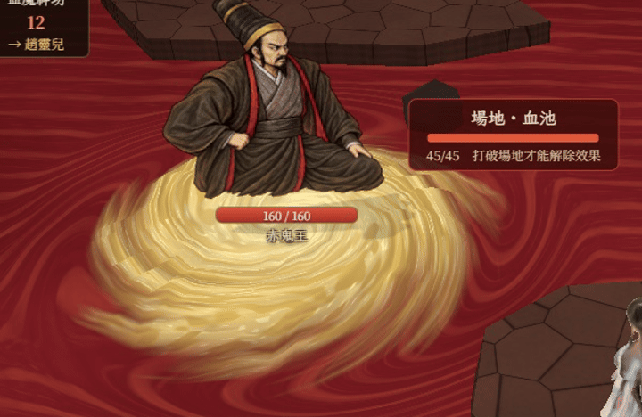

# 血池旋流修正 — SCENE-001C

2026-10-05，Codex。使用者確認赤鬼王 DOS v2「這版可以」，並指出腳下旋渦太假。

**完成 100%。** 使用者回覆「ok，繼續做其他的部分」確認新版效果；SCENE-001D 已將完整血池正式啟用，詳見 [正式接入](BLOOD_POOL_3D.md)。

## 依據與改動

沿用已查看、展示並確認的 [PAL1 DOS 血池原作](art-references/blood_pool.md)。原圖是填滿的金白翻湧水體，外緣與紅色血水相接；原先 shader 的等距黃線與空紅中心會形成靶心。

- 金白水體、暗金流帶和破碎亮浪取代等距圓環。
- 隨半徑變速的捲流搬運多尺度噪聲；周邊血水也隨之彎曲流動。
- 起伏集中於旋流，外緣逐漸接回血海；同一張連續網面沒有疊片接縫，細分集中於 Boss 周圍。
- 水體靠近袍角；姓名在亮背景上加深色描邊，保留既有站位、鏡頭與 UI 操作。
- 省電模式凍結水面動畫，仍保留相同流體形狀。





GIF 是正常實機連續取樣畫格的局部預覽，包含既有鏡頭微動；不是完整幀率錄影。

## 驗證與交接

```text
npm run build
npm test
node tools/stage/capture-blood-vortex.mjs
```

建置通過；89 個測試通過、1 跳過。場景額外 **9 draw／15,178 三角面**，低於 20 draw／30,000 面。完整舞台高畫質 **49 draw／75,341 面**、省電 **32 draw／75,324 面**；較前版增加局部水面細分，沒有增加 draw。

四組 QA 使用正式核心與 UI，三人隊、八張手牌含三張藥品、六件法寶。桌機／手機橫向／省電與正式立繪入口均無 HUD 超界，瀏覽器錯誤 0；三藥品長按可讀、放開不出牌，金創藥治療 55→75 HP，雙鞭連擊傷害 Boss 160→150 HP。另以 production 建置驗證正式 Boss URL、屈膝比例及意圖位置，治療與攻擊通過。

- [手機橫向](previews/blood-vortex/mobile.jpg)、[省電](previews/blood-vortex/mobile-low.jpg)、[藥品長按](previews/blood-vortex/mobile-medicine-2.jpg)。
- [完整驗證](previews/blood-vortex/validation.json)、[QA 與預算](previews/blood-vortex/fixture.json)、[production Boss 接入](previews/blood-vortex/production/validation.json)。

手機畫面使用桌機 Chromium 844×390、DPR 2 模擬，尚非 Android WebView 實機驗收。首次載入高低畫質的尖峰幀時亦保留於 JSON，不能把桌機 FPS 當手機效能保證。

預覽：`http://localhost:5173/?dev=3:c3_bloodpool&scenery=blood_pool&scenePerf`。赤鬼王正式資產已替換，無需 bossArt 參數。全場正式啟用與 Claude 接法見 [血池 3D](BLOOD_POOL_3D.md)。
