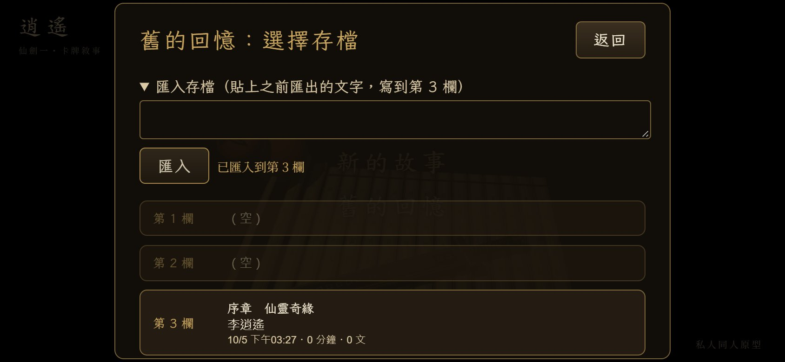

# QA-003 手機觸控流程與存檔搬移

2026-10-05，Codex 接手；使用者指示跳過 Claude 登入／派工。

## 修復

全新手機／瀏覽器沒有本機存檔時，舊的回憶按鈕原本停用，導致無法進入位於讀檔欄的匯入功能。TitleMenu 加明確 allowMemoryImport 選項；正式 GameApp 啟用，原型仍維持無記憶不可續玩。新增手機提示並重跑自帶字型。

src/App.tsx 本來有 Claude 未提交的正式入口串接。Codex 只改本次兩行選項／提示，既有內容保留；本次差異另存 [patch](patches/qa003-app.diff)，等待正式入口一起提交。其他新程式、字型、驗證與文件由 Codex 提交。

## 可重跑的驗證

先 npm run build，啟動 production preview 的 5174 埠，再執行 `node tools/qa/mobile-flow.mjs`。可用 CAPTURE_BASE_URL 指定相同 production build 的其他地址。

844×390 DPR2、hasTouch，正常 UI 以 touchscreen.tap／locator.tap 操作，存檔文字透過 textarea 輸入；隔離測試瀏覽器不改使用者存檔。

- 新故事→存檔欄→序章／劇情→地圖→第一場戰鬥：成功。
- 重載→舊的回憶→第 1 欄，seed、進度、HP／牌組、銅錢及完整戰鬥資料一致。
- 匯出按鈕真實寫入剪貼簿，內容與目前保存的 run 一致。
- 另一個乾淨 browser context 無本機存檔也能進入匯入。
- 無效文字拒絕、不寫入第 3 欄；有效文字即時啟用第 3 欄，讀入相同戰鬥。
- 瀏覽器錯誤 0；共 9 項驗證通過；build、89 測試通過／1 跳過。

[JSON 結果](previews/mobile-flow/validation.json)

這是 Chromium 手機觸控模擬；不是實體 Android／iPhone 效能驗收，也不是九章全 UI 通關驗收。既有核心 bot 通關另列任務表。
