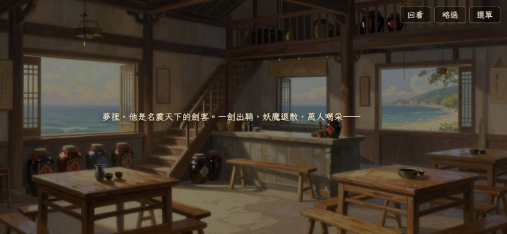
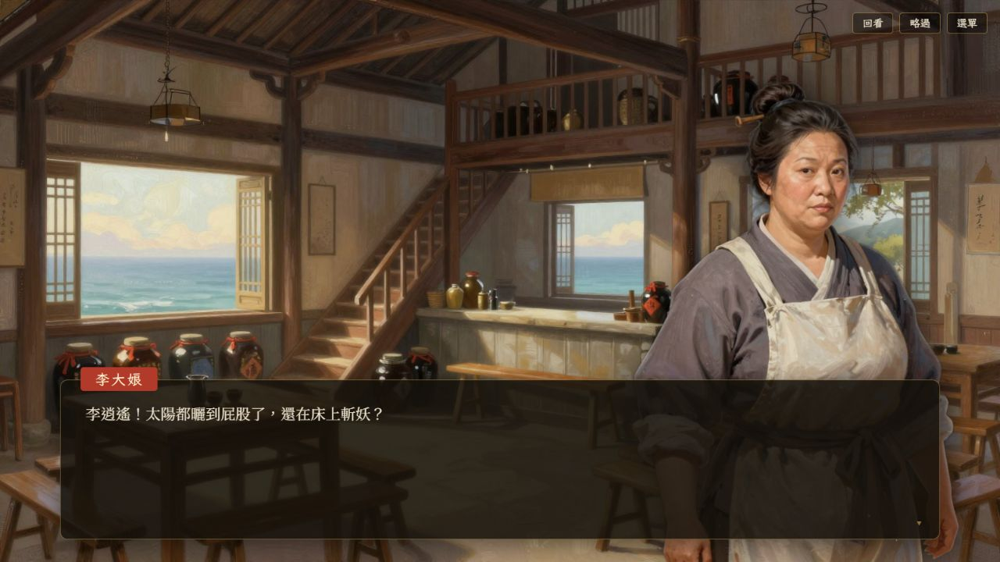

# 劇情逐字文字固定排版 — STORY-001

2026-10-05，Codex。使用者要求逐字顯示不要強制置中，避免文字位置不斷變化。

旁白段落固定寬度 `min(34em, 100%)` 並靠左；角色台詞也明確靠左。StoryText 將尚未顯示的字放在 `visibility: hidden`、`aria-hidden` 的 span，保留整句的寬度與行數，逐字揭露時文字區不會隨內容長度增長而移位。閱讀區仍在畫面中間，但文字從固定左緣開始。

## 驗證

- `npm run build` 通過。
- 手機橫向 844×390：旁白從「夢」到整句，第一字 x=169.55、y=185.09；段落 x/y/width/height 完全一致。
- 桌機 1280×720：角色台詞從部分文字到整句，段落與對話框 x/y/width/height 完全一致。
- [手機量測](previews/story-text-v1/position-mobile.json)、[桌機量測](previews/story-text-v1/position-desktop.json)。尺寸模擬，不是實體手機效能驗收。
- 修改範圍：src/ui/story/StoryScreen.tsx、src/ui/ui.css；不改劇本、字速與選項規則。未新增鏡像實作的單元測試。

## 發布

原私人網址部署 `appgdep_6ac3ab5ffb848191a8904e2b35f736b0` succeeded；Sites source SHA `2b73b6896a7ab422ef9fa0c1ff32d7b3e3c89147`。修正／驗證／發布完成 100%。
