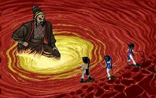
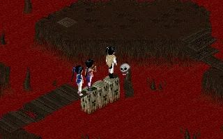

# 血池戰場原作參照 — SCENE-001B

2026-10-05，Codex。使用者已指示開工，並在看過以下兩張圖片後回覆「按原作圖製作」。原作參照 Gate 已完成，可以製作獨立候選；後續 Boss 與旋流候選已獲使用者確認，完整 3D 血池正式啟用，詳見 ../BLOOD_POOL_3D.md。

## 版本與來源

- 版本：PAL1 DOS 原作畫面。來源文章標示 DOS 版，實際查看兩張圖片的像素畫面。
- [來源文章](https://codingman.cc/pal-dos-walkthrough/)。文章有 AI 生成文字提醒；本任務只依實際遊戲截圖辨識造型，不用攻略文字取代圖片。
- [血池戰鬥原圖](https://codingman.cc/images/pal-dos-walkthrough/ch3-27-chiguiwang-start.webp)。
- [血池地圖原圖](https://codingman.cc/images/pal-dos-walkthrough/ch3-25-xuechi-puppet-worms.webp)。
- 本資料夾 PNG 是瀏覽器可見原圖的局部截圖，已實際查看；不作為遊戲貼圖。

## 可辨識元素

- 戰鬥：整片紅色血水，有條狀波紋；敵方左側金黃漩渦；我方右側為暗紅岩岸。畫面採斜向俯視。
- 地圖：暗色平頂岩島、環繞的紅色血水、窄木橋、骨骸與骷髏形柱狀物。
- 這兩張圖中沒有目前第一版背景那種高大的祭壇柱。不得把目前生成圖的裝飾直接宣稱為 PAL1 原作元素。
- 本批不修改赤鬼王、血池敵方立繪、角色或戰鬥規則。

## 工作與交接

- 工作範圍與狀態在 TASKS.md 的 SCENE-001B。
- 原作參照已確認；座標對齊工具、素材／效能檢查與原背景基準截圖先完成。
- 依原作元素製作獨立候選，保留固定鏡頭、角色站位、手牌與意圖可讀性，完成桌機／手機尺寸驗收，再交由使用者美術驗收。
- 場景額外預算：20 draw、30,000 三角面；全場與手機 GPU 仍需另測。
- 候選不替換正式 `public/assets/battle/blood_pool.jpg`，先以開發預覽入口驗收，正式啟用等使用者確認候選畫面。
- 候選已完成技術交付（100%）；五組正式戰鬥 UI 與手機藥品補驗通過，使用者美術驗收仍待確認。程式與交接見 [血池 3D 候選](../BLOOD_POOL_3D.md)。
- 後續回饋：使用者確認赤鬼王 DOS v2，指出旋渦太假；SCENE-001C 已改成填滿的金白翻湧水體、差速流動及周邊血水捲流，交付 90% 待視覺驗收。最新 [實機／動畫與驗證](../BLOOD_VORTEX.md)。
