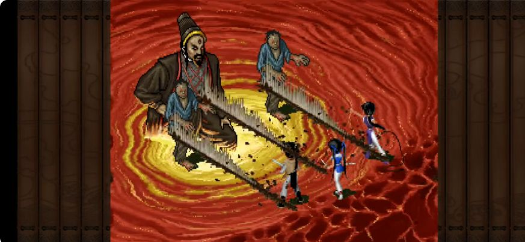
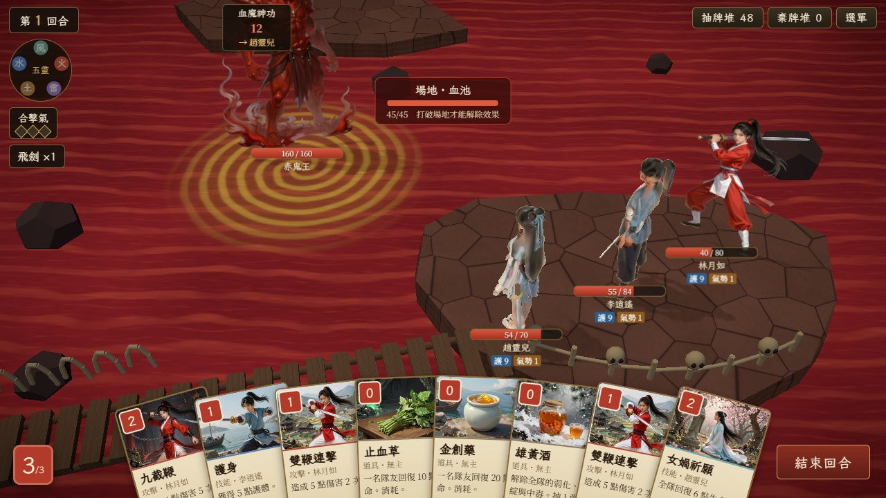

# 赤鬼王原作造型修正 — ART-001B

2026-10-05，Codex。使用者指出血池預覽的 Boss 形象與原作差距太大。

目前修正進度 **100%（原作造型與正式接入完成）**。使用者在 2026-10-05 確認「這版可以」，DOS v2 已替換正式立繪，保留屈膝比例與意圖偏移；共用批次的赤鬼王描述也已修正。使用者同時指出旋渦太假，另列 SCENE-001C；整場 3D 血池仍待驗收。

## 實際查看的原作

- 版本：PAL1 DOS 原作；本輪在瀏覽器播放並暫停實際戰鬥，並非依攻略文字猜測造型。
- 來源：[廖志超《仙劍奇俠傳DOS BOSS戰 赤鬼王》](https://www.youtube.com/watch?v=z8d42lhjG7M&t=60s)，影片 1:00 的戰鬥畫面。
- [含影片標題的來源截圖](red-ghost-king/dos-video-source.png)與下方戰鬥截圖均由瀏覽器保存，僅作參照，不作遊戲貼圖。
- 先前確認的[血池原作參照](blood_pool.md)也能辨識相同高帽、寬袍輪廓；本次另核對實際 Boss 戰。



## 與修正前立繪的差異

| 部位 | DOS 實際戰鬥可見特徵 | 修正前 `red_ghost_king.webp` |
|---|---|---|
| 頭部輪廓 | 高而向後傾的深色帽，金色帽帶 | 巨大彎曲惡魔角 |
| 面孔 | 淺色人形面孔，深色鬍鬚 | 紅色獸化臉、突出獠牙 |
| 衣著 | 深褐／近黑寬袍、大袖，灰色與紅色交領細節 | 裸露肌肉胸腹、尖刺肩部與破布裙 |
| 姿態 | 上身朝向右側隊伍，手臂收在腰附近；袍下緣與金色血池旋流相接 | 直立展開的完整惡魔身體，灰紅煙焰 |



錯誤已定位到 `tools/art/make_assets.py:64`：原描述直接要求 `huge horns and fangs` 的紅色惡魔；其完整展開版本位於 `tools/art/prompts/assets.json:480`。這是美術描述偏離原作，與 Three.js 載入或翻轉無關。通用 STANDEE 又要求頭到腳完整顯示，沒有針對血池中的袍服姿態處理。

Codex 在場景預覽沿用了現有敵人資產，沒有攔下造型明顯不符的問題。現用圖不能被當成已通過原作 Gate 的設計基準。

## 確認、候選與交接

- 已展示上方 DOS 戰鬥圖、來源與可辨識元素；使用者確認「按原作繪製，不像就再重繪」。本次與後續修正沿用相同已確認參照，不需重新詢問是否製作。
- 已由 Codex 新增獨立候選圖與獨立提示詞紀錄，未修改 Claude 的共用批次、未覆蓋正式 `public/assets/enemies/red_ghost_king.webp`。
- 正式舞台預覽保留既有站位、鏡頭、戰鬥規則與 3D 血池。角色候選需與金色旋流銜接，避免另一張池面遮住 3D 水面。
- 畫面驗收涵蓋桌機、手機橫向、藥品手牌與多件法寶的擁擠 UI，確認 Boss 朝向、帽頂、姓名、意圖與操作可讀。
- 使用者確認候選實機畫面後，才替換正式立繪並更新批次描述，避免重跑時回復錯誤造型。整場確認前維持 SCENE-001B 開發候選狀態。

## 首次候選交付與實機檢查（歷史紀錄）

- 工具：內建 imagegen，透明背景。v1 保留 DOS 帽、鬍鬚、寬袖與屈膝姿態，但多出眉心記號；v2 單獨去掉該細節。已自行比對原作與候選。
- [v2 遊戲用候選](../../public/assets/enemies/candidates/red_ghost_king_dos_v2.webp)：1222×1287、RGBA、1,119,834 bytes。只做 WebP 無損編碼，逐 byte 驗證解碼後 RGBA 與生成 PNG 相同；未手動改圖或裁切。
- [兩版完整提示詞](../../tools/art/prompts/codex_red_ghost_king_dos.md)。大型原始 PNG 保存在 `source_art/enemies/codex/`，沿用原圖忽略規則；遊戲用候選已入庫。
- 預覽網址：`http://localhost:5173/?dev=3:c3_bloodpool&scenery=blood_pool&scenePerf&bossArt=red_ghost_king_dos`。
- `src/stage/artCandidates.ts` 只處理 dev、blood_pool 與原本赤鬼王立繪 URL 的精確組合。正式建置的 JS 不含候選選擇器；明確自訂資產 URL 保持原值。
- DOS 屈膝造型的候選高度設為 1.9；意圖錨點向左偏 1.5 世界單位，保留既有角色站位、鏡頭與演出。Projector 與 Html 疊層共用可選 `StageActor.headOffset`，未設定時保持原有行為。靜止時完整帽頂、臉與袍服可見，意圖不遮臉。
- 出招推鏡時帽頂仍可能短暫超出上緣，與既有共用鏡頭有關；已查看出牌截圖，臉部與意圖仍可讀，返回靜止後帽頂完整。若要求全部推鏡影格都保留帽頂，需另調整共用演出構圖。

```text
npm run build
npm test
node tools/stage/capture-red-ghost-king.mjs
```

建置通過；87 個測試通過、1 跳過。四組瀏覽器驗證（既有資產桌機對照、新候選桌機／手機／省電）全部通過，錯誤 0。每組持有三張藥品卡、六件法寶、八張手牌；藥品長按可讀、放開不出牌，金創藥治療李逍遙 55/84→75/84；選 Boss 打出雙鞭連擊，敵人 HP 160→150，目標與受擊演出正常。

三組候選均成功載入 v2，HUD 未超界，意圖在 Boss 身體左方。全場高畫質 49 draw／64,589 面，省電 32 draw／64,572 面；額外 3D 血池仍為 9 draw／4,426 面。手機是桌機 Chromium 的 844×390、DPR 2 版面模擬，尚非 Android WebView 實機效能驗收。

- [桌機擁擠 UI](../previews/red-ghost-king/desktop.jpg)、[手機橫向](../previews/red-ghost-king/mobile.jpg)、[手機省電](../previews/red-ghost-king/mobile-low.jpg)。
- [手機長按藥品](../previews/red-ghost-king/mobile-medicine-2.jpg)、[對 Boss 出牌／受擊](../previews/red-ghost-king/mobile-attack.jpg)。
- [完整驗證結果](../previews/red-ghost-king/validation.json)、[QA 藥品與法寶](../previews/red-ghost-king/fixture.json)。

正式接入已完成：正式 WebP 與 v2 候選檔案完全相同；`presentBossArt` 在 production 保留 1.9 高度及意圖偏移，明確自訂資產不受影響。`make_assets.py`／`assets.json` 已改成 DOS 高帽、鬍鬚、寬袍與屈膝描述，本機忽略的 jobs/enemies.json 赤鬼王條目也已同步。沒有重跑或改動其他敵人的批次。正式建置瀏覽器治療與攻擊通過，錯誤 0；[正式接入驗證](../previews/blood-vortex/production/validation.json)。SCENE-001B 全場 3D 仍需場景驗收。

進度計算：定位原因 10%、實際查看與展示原作 10%、參照確認 10%、候選製作 30%、舞台預覽 20%、技術驗收 10%、使用者視覺驗收 10%。全部完成，目前 100%；使用者確認只適用赤鬼王造型，旋渦另見 [修正交付](../BLOOD_VORTEX.md)。
