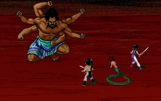
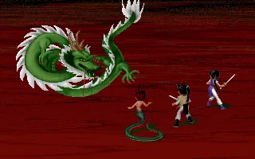
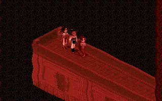

# 鎖妖塔 Boss 戰場原作參照 — SCENE-002

2026-10-05，Codex。已線上取得並實際查看下列 DOS 遊戲截圖，已在對話中展示；2026-10-05 最新使用者授權自主核對／製作，不再等逐張確認；已完成暗紅全地面 3D，見 docs/ALL_SCENES_3D.md。以下初次交付描述保留為歷史，最新狀態以 TASKS.md 為準。

## 原作圖

來源文章：[CodingMan.cc 的 PAL1 DOS 全流程](https://codingman.cc/pal-dos-walkthrough/)。文章有 AI 文字提醒，此處只以實際遊戲圖辨識視覺，正史仍核對 SwordCard/docs/PAL1_CANON.md。

[原圖](https://codingman.cc/images/pal-dos-walkthrough/ch6-24-mingwang-start.webp)。可見暗紅橫向細紋的全地面背景、左上敵方與右下隊伍；上緣仍是地面，沒有天空、屋瓦平台或外部宮殿。角色只作位置比例參考，本批不改 Boss 造型。

[原圖](https://codingman.cc/images/pal-dos-walkthrough/ch6-28-longfeng-start.webp)。背景同樣為暗紅橫紋場地，左方青綠盤龍、右方隊伍；不把龍身當成場景固定裝飾。

[原圖](https://codingman.cc/images/pal-dos-walkthrough/ch6-27-qixing-pillar.webp)。可見黑暗空間中的紅色長方劍柱台座、台座斷面與紅色柱身；圖中台座適合作探索場景元素參照，不能宣稱戰鬥原圖也有七根巨柱。

## 現況與範圍

目前 `tower_top` 同時被 `c6_mingwang`、`c6_dragons` 使用；名稱是內容內部 ID。第一版生成描述為屋頂平台與龍柱，與本次查看的戰鬥背景有差異。

原作劇情從塔上往下走，七星磐龍柱位於塔底支撐；不因內部 ID 名稱就把它畫成露天塔頂。內容名稱／章節規則屬 Claude，Codex 不在本批修改；需留共同交接。

取得參照確認後再做 3D 候選：固定鏡頭與站位、暗紅層紋地面、低矮幾何起伏；台座元素是否放入戰鬥、放在哪裡，需保留原作全地面與 UI 閱讀空間。完整方案／最終 prompt 在參照確認後才撰寫。

進度 **15%：原作核對、圖片查看／展示完成；尚待參照確認**。依 AGENTS.md 的「取得使用者確認後，才可……生成候選圖或修改正式資產」執行。

最新交付：SCENE-002 隨 SCENE-003 完成 100% 技術接入／桌機與手機驗收。tower_top 保留明王／神龍原作暗紅橫紋，不把探索圖七根柱子移植到戰鬥中央；使用者視覺試玩另列。
